<p align="center">
  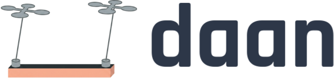
</p>

<p align="center">
  <strong>Python models and controllers for quadrotors carrying cables, payloads and hoses, with analytical and MuJoCo backends.</strong>
</p>

<p align="center">
  <a href="https://github.com/vkotaru/udaan/actions"></a>
  <a href="https://github.com/vkotaru/udaan/blob/main/LICENSE"></a>
  <a href="https://pypi.org/project/udaan/"></a>
  <a href="https://mujoco.org"></a>
</p>

---

<table align="center">
  <tr>
    <td align="center" width="25%">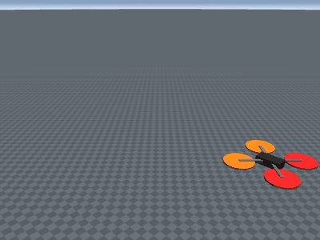<br/><sub>M1 · quadrotor</sub></td>
    <td align="center" width="25%">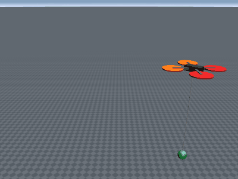<br/><sub>M2 · cable-suspended payload (tendon)</sub></td>
    <td align="center" width="25%">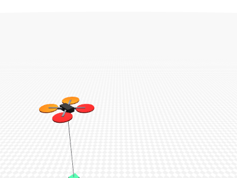<br/><sub>M2 · cable-suspended payload (link chain)</sub></td>
    <td align="center" width="25%">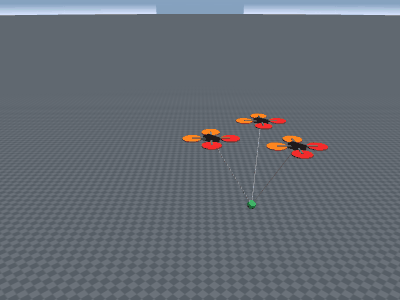<br/><sub>M3 · three quadrotors, point-mass payload</sub></td>
  </tr>
  <tr>
    <td align="center" width="25%">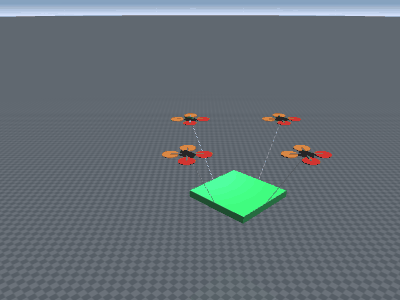<br/><sub>M4 · four quadrotors, rigid-body payload</sub></td>
    <td align="center" width="25%">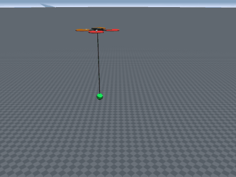<br/><sub>M5 · payload on a flexible cable</sub></td>
    <td align="center" width="25%">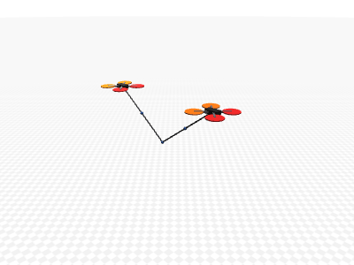<br/><sub>M6 · two quadrotors carry a hose over a box</sub></td>
    <td align="center" width="25%">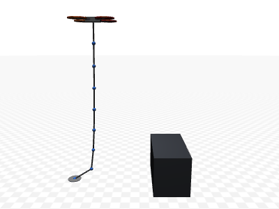<br/><sub>M7 · tethered quadrotor over a box</sub></td>
  </tr>
  <tr>
    <td align="center" width="25%">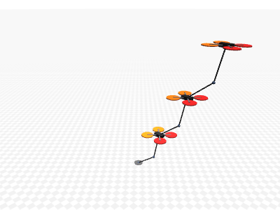<br/><sub>M8 · three quadrotors on a tethered hose over a box</sub></td>
    <td align="center" width="25%">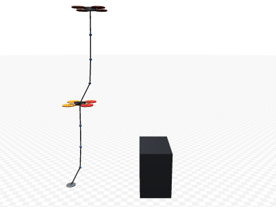<br/><sub>M8 · two quadrotors on one tether over a box</sub></td>
    <td align="center" width="25%">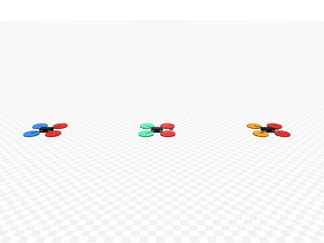<br/><sub>Fleet · PD vs L1 under a disturbance</sub></td>
    <td align="center" width="25%">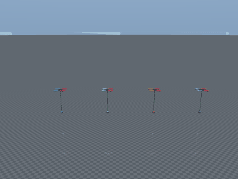<br/><sub>Payload fleet · cable-gain sweep</sub></td>
  </tr>
</table>

---

> Developed as part of the thesis: _Dynamics and Control for Collaborative Aerial Manipulation_ ([Kotaru, 2022](https://github.com/vkotaru)).
> Original research code: [vkotaru/floating_models](https://github.com/vkotaru/floating_models). This package is the public release of that code.

&#x1F681; Quadrotor dynamics &nbsp;&bull;&nbsp; &#x1F39B; Geometric control on SE(3)/SO(3) &nbsp;&bull;&nbsp; &#x26D3; Cable-suspended payloads &nbsp;&bull;&nbsp; &#x1F91D; Multi-quadrotor cooperative transport &nbsp;&bull;&nbsp; &#x1F9F5; Flexible cables and hoses &nbsp;&bull;&nbsp; &#x1F4D0; Differential-flatness feed-forward &nbsp;&bull;&nbsp; &#x1F579; MuJoCo simulation &nbsp;&bull;&nbsp; &#x1F5A5; CLI

## Systems

| | System | Pick it for | Controller | CLI (`-m base`?) |
|---|---|---|---|---|
| M1 | one quadrotor | rigid-body flight, trajectory tracking | geometric PD on SE(3), L1 adaptive | `udaan run quadrotor` (yes) |
| M2 | one quadrotor, payload on a taut cable | a point-mass payload swinging below one vehicle | geometric cascade: payload, cable, attitude | `udaan run quad-payload` (yes) |
| M3 | `nQ` quadrotors, one point-mass payload | cooperative transport of a small load | M2's cascade with a tension split across cables | `udaan run multi-quad-payload` or `multi-quad` (no) |
| M4 | `nQ` quadrotors, one rigid-body payload | carrying a load whose attitude matters | cascade with wrench allocation to cables | `udaan run multi-quad-rigidbody` or `multi-quad-rigid` (no) |
| M5 | one quadrotor, payload on an `n`-link cable | a cable that bends | LQR (linear-quadratic regulator) | `udaan run quad-flexcable` (yes) |
| M6 | `nQ` quadrotors in series on an `n`-link hose | a hose carried by several vehicles | LQR | `udaan run hose` (yes) |
| M7 | one quadrotor on a tether pinned to the ground | a tethered vehicle | LQR | `udaan run tethered-quad` (yes) |
| M8 | `nQ` quadrotors on a hose pinned to the ground | a hose lifted from a ground anchor | LQR | `udaan run tethered-hose` (yes) |

Each system lives in its own package under `udaan.models` (M7 and M8 share
`udaan.models.tethered_hose`) with an analytical model (`...Base`) and a MuJoCo
backend (`...Mujoco`, the CLI default). `udaan.flatness` maps a smooth reference
to feed-forward states and inputs for each system. The front (+x) rotors of
every quadrotor are red, so heading is visible in renders. The dynamics,
controllers and flat maps are derived in the
[theory pages](https://udaan.readthedocs.io/theory/index.html).

Also provided, all on MuJoCo:

- `QuadrotorFleet` (`udaan run fleet`) and `QuadrotorCsPayloadFleet`
  (`udaan run cspayload-fleet`): several M1 or M2 vehicles side by side, each in
  its own lane with its own controller, for comparing controllers and gains.
- `QuadrotorComparison`: a plant and a reference quadrotor in one scene, stepped
  from Python.
- `MultiQuadrotorCSPointmass` and `MultiQuadRigidbody` in `udaan.models.mujoco`:
  quadrotors that hold a fixed formation under a shared payload, with no
  payload trajectory, stepped from Python.
- The point-mass models in `udaan.models.base`, stepped from Python.

## Installation

```bash
pip install udaan
```

MuJoCo is a core dependency. The extras are `dev` (tests, linters), `docs`
(Sphinx), `rl` (Gymnasium, Stable-Baselines3), `plot` (Bokeh) and `mcp` (the
MCP server below); `all` installs every one:

```bash
pip install "udaan[all]"
```

For development:

```bash
git clone https://github.com/vkotaru/udaan.git
cd udaan
pip install -e ".[all]"
```

## Quick start

### CLI

```bash
# M1: quadrotor with geometric SE(3) control
udaan run quadrotor                                    # MuJoCo viewer, hover
udaan run quadrotor -m base                            # analytical model, no window
udaan run quadrotor --traj circle                      # 1 m radius circle, from rest
udaan run quadrotor --traj spiral                      # helix about a horizontal axis
udaan run quadrotor --traj lissajous                   # 3D Lissajous
udaan run quadrotor --traj flip                        # vertical loop
udaan run quadrotor --traj step                        # setpoint step (no feed-forward)
udaan run quadrotor --traj mission                     # take off, waypoints, land
udaan run quadrotor --traj figure8                     # figure-8 with yaw

# M2: cable-suspended payload
udaan run quad-payload -c tendon                       # spatial-tendon cable
udaan run quad-payload -c links                        # 10-link chain cable
udaan run quad-payload --traj circle                   # payload on a 1 m radius circle
udaan run quad-payload --traj spiral -m base           # horizontal helix, analytical model

# M3, M4: cooperative transport
udaan run multi-quad-payload -n 3                      # three quadrotors, point-mass payload
udaan run multi-quad-rigidbody -n 4                    # four quadrotors, rigid-body payload

# M5, M6: flexible cable and hose
udaan run quad-flexcable --traj lissajous              # payload on a 3-link cable
udaan run quad-flexcable -n 5 -m base                  # 5 links, analytical model
udaan run hose --traj lissajous                        # two quadrotors on a 4-link hose
udaan run hose -n 4 -a 0,2,4                           # 4 links, quadrotors at vertices 0, 2, 4

# M7, M8: hose pinned to a ground anchor
udaan run tethered-quad --traj circle                  # circle about the anchor, from rest
udaan run tethered-hose --traj climb                   # three quadrotors, blend to a higher, closer position

# Side-by-side comparisons
udaan run fleet --demo l1-comparison                   # PD vs L1 adaptive under a disturbance
udaan run fleet --demo gain-sweep                      # PD gains × [0.25, 0.5, 1, 2]
udaan run cspayload-fleet --demo same-gains            # two agents, default gains
udaan run cspayload-fleet --demo gain-sweep            # cable gains × [0.5, 1, 1.5, 2]

# Headless runs and recording
udaan run multi-quad-payload --no-render -t 5          # MuJoCo without a window
udaan run quadrotor -t 5 -r out.gif                    # save to GIF
udaan run quadrotor --traj spiral -r spiral.mp4        # save to MP4
udaan generate-xml hose -n 4 -a 0,2,4 -o hose.xml      # write the generated MuJoCo XML (MJCF)
```

Every command takes `--help`. Short flags differ between commands: `-n` counts
quadrotors on `multi-quad-*` and `fleet` but links on `quad-flexcable`, `hose`
and `tethered-*`. The gallery above is recorded headless with
`scripts/record_gallery.py`.

### Python

```python
from udaan.models.quadrotor import QuadrotorBase, QuadrotorMujoco

# Analytical model, no window: fly from (1, 1, 0) m for 10 s
mdl = QuadrotorBase()
mdl.simulate(tf=10, position=[1., 1., 0.])

# MuJoCo with the viewer
mdl = QuadrotorMujoco(render=True)
mdl.simulate(tf=10, position=[1., 1., 0.])
```

## Use with Claude (MCP / skill)

udaan ships an MCP server, `udaan-mcp`, and an Agent Skill, `skills/udaan/SKILL.md`.
With them Claude can list the systems, fly any of them headless, record an
offscreen MP4 or GIF, export MJCF and check a payload reference. Every run is
bounded in simulated time and wall time.

```bash
pip install "udaan[mcp]"
claude mcp add udaan -- udaan-mcp        # Claude Code; other clients: {"command": "udaan-mcp"}
```

The repository is also a Claude Code plugin with the skill and the server:
`/plugin marketplace add vkotaru/udaan`, then `/plugin install udaan@udaan`. See the
[MCP guide](https://udaan.readthedocs.io/guides/mcp.html) for the
tools and the systems.

## Documentation

Guides, the theory behind each model and controller, and the API reference are
at [udaan.readthedocs.io](https://udaan.readthedocs.io).

## License

BSD 3-Clause License; see [LICENSE](https://github.com/vkotaru/udaan/blob/main/LICENSE).
